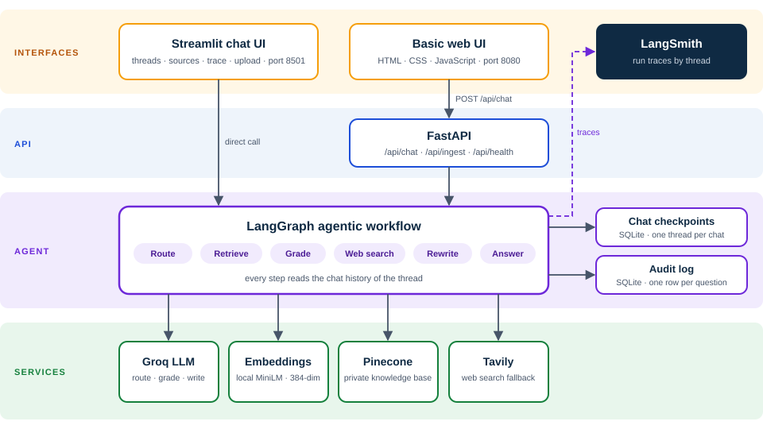
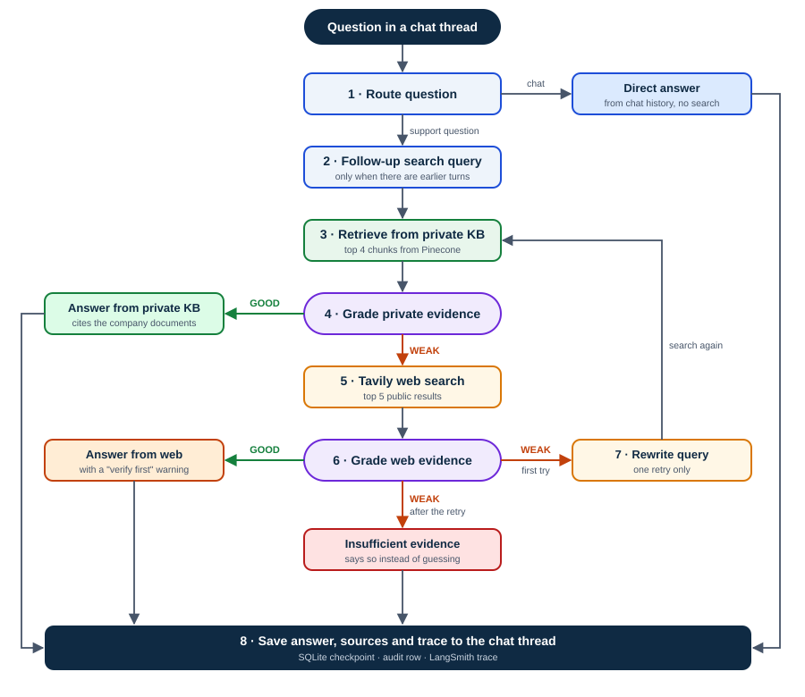
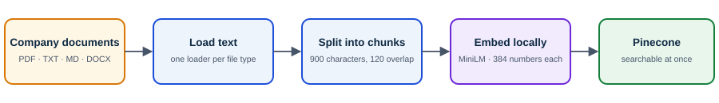
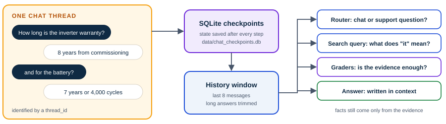

<svg class="sun" viewBox="0 0 200 200" xmlns="http://www.w3.org/2000/svg"><g stroke="#FCD34D" stroke-width="5" stroke-linecap="round" opacity=".55"><line x1="100" y1="6" x2="100" y2="30"/><line x1="100" y1="170" x2="100" y2="194"/><line x1="6" y1="100" x2="30" y2="100"/><line x1="170" y1="100" x2="194" y2="100"/><line x1="33" y1="33" x2="50" y2="50"/><line x1="150" y1="150" x2="167" y2="167"/><line x1="33" y1="167" x2="50" y2="150"/><line x1="150" y1="50" x2="167" y2="33"/></g><circle cx="100" cy="100" r="52" fill="#F59E0B" opacity=".9"/><circle cx="100" cy="100" r="36" fill="#FCD34D" opacity=".9"/></svg>

Project guide

<h1>SunDesk Copilot</h1>

An agentic RAG support assistant that answers from company documents first, remembers the conversation, and shows its reasoning.

Customer<b>Aravalli Solar Works (fictional)</b>

Users<b>Service Desk agents and field engineers</b>

Use case<b>Troubleshooting, warranty, installation, billing</b>

Built with<b>LangGraph · Groq · Pinecone · Tavily · Streamlit · LangSmith</b>

Aravalli Solar Works is an invented company. Every name, price, error code and policy in the sample knowledge base was written for this project.

## 1 The Problem

Aravalli Solar Works installs and maintains rooftop solar systems across four service regions. Its support knowledge exists, but it is slow to find.

Service Desk agents and field engineers answer the same questions many times a day:

- What does this error code mean, and what should the customer check first?
- Is this fault covered under warranty?
- How long does installation take, and what must the customer provide?
- Why has the customer's electricity bill not dropped?

The answers are spread across an installation guide, a troubleshooting runbook, a warranty policy, a billing FAQ and a safety handbook. Agents search several documents while the customer waits, and different agents give different answers.

### Three approaches that fall short

<h4>Keyword search</h4>
Returns whole documents instead of one clear answer. The agent still has to read and decide.

<h4>A plain chatbot</h4>
Answers confidently even when it has no company information, so wrong answers sound right.

<h4>Private documents only</h4>
Cannot answer questions that depend on current public facts, such as subsidy amounts.

The core business challengeStaff need fast answers. The company needs those answers to be grounded in its own documents whenever possible, clearly labelled when they are not, and traceable afterwards.

## 2 Why Simple RAG Is Not Enough

Retrieval-augmented generation (RAG) means finding relevant text first and letting the model answer from it. The simple version has one fixed path, and that is where it breaks.

<h4>Simple RAG</h4><ul><li>Question, retrieve, generate: always the same path</li><li>Answers even when the retrieved text is unrelated</li><li>Uses the private knowledge base only</li><li>Treats every question as brand new</li><li>No record of why it answered as it did</li></ul>

<h4>SunDesk Copilot</h4><ul><li>Chooses its next step from what it has found</li><li>Grades the evidence before it writes anything</li><li>Private documents first, web search when needed</li><li>Remembers each chat thread</li><li>Decision trace, audit row and LangSmith run per answer</li></ul>

## 3 The Solution at a Glance

One workflow, two interfaces, and four outside services, with every answer saved and traced.

<b>6</b>company documents in the sample knowledge base

<b>35</b>searchable chunks stored in Pinecone

<b>8</b>decision steps in the agent workflow

<b>2</b>interfaces: Streamlit chat and a basic web UI

<figure class="wide"><figcaption><b>Figure 1. System architecture.</b> Both interfaces drive the same LangGraph workflow. Streamlit calls it directly; the web UI goes through FastAPI.</figcaption></figure>

### What each part does

| Part | Technology | Job |
|---|---|---|
| Agent workflow | LangGraph | Decides the next step from the current state |
| Language model | Groq, `openai/gpt-oss-20b` | Routes, grades evidence, rewrites queries, writes answers |
| Embeddings | `all-MiniLM-L6-v2`, runs locally | Turns text into 384 numbers so similar meanings sit close together |
| Vector database | Pinecone | Stores the private knowledge base and finds the closest chunks |
| Web search | Tavily | Fallback when the private evidence is weak |
| Chat memory and audit | SQLite | Saves every thread and logs every question |
| Observability | LangSmith | Records every step and model call, grouped by thread |

## 4 The Agentic Workflow

"Agentic" means the system decides what to do next from what it has found so far, instead of following one fixed path.

<figure class="narrow"><figcaption><b>Figure 2. Decision flow for one question.</b> Green arrows follow good evidence, orange arrows follow weak evidence.</figcaption></figure>

| Step | What happens | Model call? |
|---|---|---|
| 1 Route | Decides whether this is a support question or just conversation | Yes |
| 2 Follow-up search query | Rewrites "and for the battery?" into "Battery warranty?" for searching | Only with history |
| 3 Retrieve | Fetches the 4 closest chunks from Pinecone | No |
| 4 Grade private evidence | Judges whether those chunks can answer confidently | Yes |
| 5 Web search | Asks Tavily for public results | No |
| 6 Grade web evidence | Judges whether the web results are relevant | Yes |
| 7 Rewrite query | Adds technical keywords and tries once more | Yes |
| 8 Save | Stores the answer, sources and trace on the thread | No |

Why the grading steps matterThey are the difference between "I found something" and "I found the answer". Without them, the model would write a fluent reply from whatever was retrieved, relevant or not.

## 5 The Knowledge Base

The sample knowledge base is six original documents in `docs/knowledge_base/`.

| Document | What it covers |
|---|---|
| Company overview | Service regions, system packages, support channels, ticket priorities P1 to P4, escalation |
| Installation and commissioning guide | Project timeline, site survey checklist, installation rules, commissioning tests |
| Inverter troubleshooting runbook | Error codes AS-101 to AS-501, emergency shutdown, no-power and low-generation checks |
| Warranty and service policy | Warranty periods, exclusions, claims, maintenance plans, refunds |
| Net metering and billing FAQ | Net-meter process, payment schedule, financing, how subsidies are handled |
| Safety and maintenance handbook | Panel cleaning, engineer safety rules, maintenance checklist, storm guidance |

### How a document becomes searchable

<figure><figcaption><b>Figure 3. Ingestion pipeline.</b> The same pipeline runs for the starter documents and for anything uploaded through the UI.</figcaption></figure>

<h4>Why chunks?</h4>
A whole document is too long and too mixed to match one question. A 900-character chunk is about one topic, so the right passage can be found and quoted.

<h4>Why embeddings?</h4>
They let "my gateway is offline" find a passage titled "HelioBox Offline" even though the words differ. The model runs on your own machine, with no API key.

Writing tip learned in this projectExact codes such as AS-301 are hard for meaning-based search. The runbook states every code in a full sentence ("Error code AS-301 means the inverter is over temperature") so that both formal and casual questions find it.

Deliberately left outGovernment subsidy amounts and tariff rates change often and differ by state, so the documents do not list them. Those questions are meant to fall through to web search.

## 6 Conversation Memory

<figure><figcaption><b>Figure 4. How a chat thread is stored and used.</b></figcaption></figure>

Each chat has a `thread_id`. After every step LangGraph writes the state of that thread to a SQLite file, so chats survive a restart and can be reopened from the sidebar. The last 8 messages are passed to the router, the search-query step, the graders and the answer step.

Design choiceOnly the search query is rewritten. The user's own words are kept for the answer, and history is used to understand the question, never as a source of facts.

## 7 Worked Examples

<h4>Example 1 · Answer found in the company documents Private knowledge base</h4>

What does error code AS-210 mean?

AS-210 means an earth fault is detected. Carry out the emergency shutdown and book an urgent field visit. Priority P1.

The runbook defines the code, the evidence is graded GOOD, and no web search is made.

Router → KB▶Retrieve 4 chunks▶KB grade GOOD▶Answer from private KB

<h4>Example 2 · Private knowledge is not enough Web search</h4>

What is the current rooftop solar subsidy for homes in India?

External web information, verify with the official source before quoting: the central scheme offers a subsidy of up to ...

Subsidy figures are not in the documents. The private evidence is graded WEAK, the web evidence GOOD, and the answer carries a warning.

Router → KB▶KB grade WEAK▶Tavily search▶Web grade GOOD▶Answer from web

<h4>Example 3 · A follow-up question Private knowledge base</h4>

How long is the inverter warranty?

The inverter is covered for 8 years from the commissioning date.

and for the battery?

The SunVault battery is covered for 7 years or 4,000 cycles, whichever comes first.

The second message makes no sense alone. The thread history turns it into the search query "Battery warranty?".

Router → KB▶Follow-up query: Battery warranty?▶KB grade GOOD▶Answer from private KB

<h4>Example 4 · Questions about the conversation Direct reply</h4>

Hi, I'm Shahid. I have a 5 kW SunHome system in Pune.

Hi Shahid! How can I help you with your SunHome system?

Can you summarise what you told me so far in two lines?

A two-line recap written from the chat history.

Neither message needs a document lookup, so no search is made and no search cost is paid.

Router → DIRECT▶Direct reply, no retrieval

<h4>Example 5 · Nothing reliable found Insufficient evidence</h4>

If the private and the web evidence both stay weak after one rewrite, the system says it could not find reliable evidence and points the user to the Service Desk. It does not guess.

KB grade WEAK▶Web grade WEAK▶Rewrite query▶KB WEAK, Web WEAK▶Stopped

## 8 Seeing What the Agent Did

Three records are kept for every question, each for a different reader.

<h4>Agent trace in the UI</h4>
For the person asking. A short list of the steps taken, shown under each answer with its sources.

<h4>LangSmith run</h4>
For the developer. Every step with its prompt, response, timing and token use, grouped by chat thread.

<h4>Audit row</h4>
For the business. Question, source used and trace, stored in <code>data/audit.db</code>.

LangSmith tracing switches on automatically when `LANGSMITH_API_KEY` is present in `.env`. Runs go to the `sundesk-copilot` project.

## 9 The Interfaces

<h4>Streamlit chat UI · port 8501</h4>
New chat, saved chat list, delete chat, a coloured source badge, expandable sources and trace per answer, and document upload in the sidebar.

<h4>FastAPI and basic web UI · port 8080</h4>
A single-page chat with a live trace panel, plus REST endpoints and automatic API documentation at <code>/docs</code>.

| Endpoint | Purpose |
|---|---|
| `GET /api/health` | Health check |
| `POST /api/chat` | Send `question` and an optional `thread_id`; returns answer, source, trace and citations |
| `POST /api/ingest` | Upload a document; protected by the `X-Admin-Key` header |

The colour of the source badge tells the reader how much to trust an answer at a glance: Private knowledge base Web search Direct reply Insufficient evidence

## 10 What Was Added Beyond the Starting Template

This project began from a tutorial template for an IT-support copilot.

| Area | Change |
|---|---|
| Domain | New fictional customer, six original documents, new prompts and UI text |
| Model and embeddings | Groq and local embeddings; no OpenAI key needed |
| Conversation memory | Chat threads saved as LangGraph checkpoints in SQLite |
| Use of history | Router, graders and answer steps read earlier turns; follow-ups get a rewritten search query |
| Streamlit UI | Threaded chat with sources, trace, badges and upload |
| LangSmith | Automatic tracing with runs tagged by thread |
| Reliability | Schema-enforced routing and grading, request timeout and retries |
| API | `/api/chat` accepts an optional `thread_id` |

## 11 Walkthrough

### One-time setup

<b>Install.</b> Create and activate a virtual environment, then run <code>pip install -r requirements.txt</code>.

<b>Add keys.</b> Copy <code>.env.example</code> to <code>.env</code> and fill in the Groq, Tavily and Pinecone keys. The LangSmith key is optional.

<b>Load the knowledge base.</b> Run <code>python ingest_sample_kb.py</code>. It creates the Pinecone index on first run and uploads the six documents.

Run ingestion onceRunning it again adds duplicate chunks. Clear the Pinecone namespace first if you need to reload.

### Start the application

| Interface | Command | Address |
|---|---|---|
| Streamlit chat UI (recommended) | `streamlit run streamlit_app.py` | `http://localhost:8501` |
| FastAPI and basic web UI | `python run.py` | `http://127.0.0.1:8080` |
| API documentation | served by FastAPI | `http://127.0.0.1:8080/docs` |

### Demonstration script

Use the Streamlit UI and open "Agent trace" under each answer.

| # | Type this | What to point out |
|---|---|---|
| 1 | What does error code AS-210 mean? | Green badge, runbook cited, no web call |
| 2 | What should I check first for it? | The trace shows a follow-up search query naming AS-210 |
| 3 | How long is the inverter warranty? | Answer from the warranty policy |
| 4 | and for the battery? | A short follow-up understood from history |
| 5 | What is the current rooftop solar subsidy for homes in India? | KB graded WEAK, orange badge, warning, web links |
| 6 | Can you summarise what you told me so far in two lines? | Blue badge, answered from the conversation |
| 7 | Click "New chat", then reopen the first chat | The conversation is restored from SQLite |
| 8 | Stop and restart Streamlit | Saved chats are still listed |
| 9 | Upload a document under "Add company document" | Ask about it straight away; admin key is `change-me` unless set |
| 10 | Open the `sundesk-copilot` project in LangSmith | Each question is one run; expand it to see every step |

## 12 Business Value

<h4>Shorter handling time</h4>
One answer instead of a search through several documents.

<h4>Consistent answers</h4>
Every agent reads from the same policies and runbooks.

<h4>Fewer wasted visits</h4>
First checks from the runbook come before a field visit is booked.

<h4>Safer answers</h4>
Private knowledge preferred, web answers labelled, and honest when it does not know.

<h4>Traceability</h4>
A decision path, an audit row and a LangSmith run for every answer.

<h4>Easy upkeep</h4>
New policies are added by uploading a document, not by editing code.

## 13 Known Limitations and Next Steps

| Limitation today | A sensible next step |
|---|---|
| Groq free-tier rate limits slow answers; one question makes 3 to 9 model calls | Use a paid tier, or merge the routing and query steps into one call |
| The small model occasionally adds a detail that is not in the documents | Switch to a larger model and add an answer-faithfulness check |
| Search is by meaning only | Add keyword search alongside it for exact codes and names |
| Re-running ingestion duplicates chunks | Give each chunk a stable ID so reloads overwrite |
| One shared admin key, no user login | Add sign-in and per-user chat lists |
| Web results can be wrong for company-specific terms | Skip web search when the question names an internal code |

## 14 Glossary

| Term | Plain meaning |
|---|---|
| RAG | Retrieval-augmented generation: find relevant text first, then let the model answer from it |
| Agentic | The system chooses its next step from what it has found, instead of following a fixed path |
| Chunk | A short passage cut from a document so it can be searched and quoted |
| Embedding | A list of numbers that represents the meaning of a piece of text |
| Vector database | A store that finds the passages whose embeddings are closest to the question's |
| Grounded answer | An answer written only from supplied evidence |
| Thread | One saved conversation, identified by a `thread_id` |
| Checkpoint | A saved snapshot of the workflow's state for a thread |
| Trace | The list of steps the agent took for one question |

Rebuilding this documentEdit <code>docs/SunDesk_Copilot_Project_Guide.md</code>, then run <code>python docs/build_pdf.py</code>. The diagrams are SVG files in <code>docs/assets/</code> and the styling is in <code>docs/assets/guide.css</code>.

